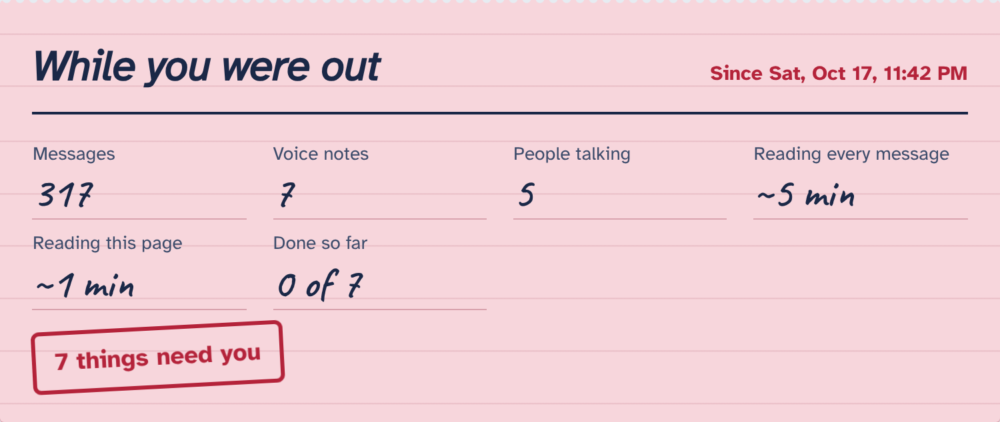

# Rejoin

[](https://github.com/ShermaineYap/Taskforge-Hack/actions/workflows/tests.yml) [](https://shermaineyap.github.io/Taskforge-Hack/)

**Missed the group chat? Get only the parts that need you.**

Rejoin turns a WhatsApp chat export into a personal handoff: what was asked of you, what's waiting for your answer, what was decided while you were away, and every date that matters. Each item links to the exact message it came from, so you can trust it without scrolling back through hundreds of messages.

**Try it now: [https://shermaineyap.github.io/Taskforge-Hack/](https://shermaineyap.github.io/Taskforge-Hack/)** (runs entirely in your browser; nothing is uploaded)

Built for the [Taskforge hackathon](https://taskforge.devpost.com/) (October 2026).



## The person and the barrier

**Aina** is a final-year student. During a week of exams and work shifts she mutes her six-person FYP group chat. She comes back to **317 messages and 7 voice notes**. Somewhere in there, she was assigned the literature review, asked to book a room in a voice note, asked a direct question, and the referencing style changed under her.

For many people, re-entering a long chat is the barrier, not the work:

- **ADHD and anxiety:** a wall of unread messages is easy to avoid and hard to start. Avoiding it is how assigned tasks get missed.
- **Dyslexia and second-language readers:** hundreds of short, slangy, mixed-language messages are slow and tiring to decode.
- **Deaf and hard-of-hearing people:** information said only in a voice note is simply not available to them.

WhatsApp itself has no "what did I miss that involves me?" view. Rejoin is that view.

## What it does

1. **Export** the chat from WhatsApp (built into the app, no account linking or API access).
2. **Drop it into Rejoin** with your name and nicknames. By default it catches you up on everything since your own last message.
3. **Get the handoff:**
   - **Asked of you**, with who asked, when, and the due date. Tick items off as you go.
   - **Waiting for your answer**, including "everyone please confirm" requests.
   - **Decided while you were away**: format changes, new dates, scope changes.
   - **Dates**, with one-click export to your calendar (.ics).
   - **A message to rejoin with**, ready to copy into the group.
4. **Check any item:** "Show the message" reveals the original text, and "Find it in the full chat" jumps to it in context.

The filled-in slip shows the change directly: **317 messages, ~5 minutes of reading plus scrolling, became 7 things that need you and about 1 minute of reading.**

## Accessibility is the feature

| Need | What Rejoin does |
| --- | --- |
| Low vision, dyslexia | Set in Atkinson Hyperlegible (designed by the Braille Institute). Toggles for larger text, extra letter/line spacing, high contrast, and a plain typeface everywhere. |
| Cognitive load | Only the items that involve you. Plain-language mode rewrites each item in short, common words. |
| Deaf / hard of hearing | Voice notes in a "with media" export are transcribed (Whisper) and treated like text. |
| Reading fatigue | "Read it to me" uses the browser's speech engine, with adjustable speed. |
| Screen readers, keyboard | Semantic landmarks and headings, a skip link, labelled controls, `aria-expanded` disclosures, a live region announcing results, focus moved to results, every control keyboard-operable. |
| Motion sensitivity | Respects `prefers-reduced-motion`, plus a "no motion" switch. |
| Light and dark | Full dark theme following the system setting. |

**Verified:** 0 axe-core violations (WCAG 2.0/2.1/2.2 A and AA rules) across 17 states: light and dark, desktop and 375 px mobile, comfort panel open, results expanded, plain language on, and high-contrast + large-text mode. The keyboard-only path (Tab to the demo, Enter, focus lands on results, status announced) is tested in the same script. See [`docs/a11y-report.json`](docs/a11y-report.json).

Automated scans catch only part of real accessibility problems. Rejoin has not yet been tested with disabled users; that's the next step.

## How it works

```
WhatsApp export (.txt or .zip)
  → parser            Android/iOS, 12h/24h, day- or month-first, multi-line messages
  → voice notes       Whisper transcription (zip exports)
  → redaction         phone numbers and e-mails masked, unsaved contacts renamed
  → window            since your last message / 24h / 3 days / 7 days / all
  → reader            AI (Groq, Llama 3.3 70B) or offline rules
  → grounding check   every item must cite a real message in the window, or it's dropped
  → date resolution   "tmr night", "Monday 2pm", "Fri 30 Oct 11.59pm" resolved in code
                      relative to when each message was sent
  → handoff page
```

**Why the model doesn't get the last word.** The AI reader only proposes items. Rejoin's code then:

- drops any item that doesn't cite a message ID that exists in the catch-up window,
- re-resolves every date itself from the cited message's timestamp (models are unreliable at "what date is next Monday?"),
- flags any "asked of you" item whose source message never names you as **"Check: not named directly"**.

**Offline engine.** With no API key, or if the API fails, Rejoin uses a deterministic rule engine (request cues, @mentions, task-split lists like `Aina - lit review`, decision cues, Malay/Manglish phrases such as *boleh tak* and *tolong*). The demo never breaks during judging.

## Evaluation

Two labelled, fictional chats ship with the repo:

| Chat | Engine | Precision | Recall | F1 |
| --- | --- | --- | --- | --- |
| Aina's FYP group (Android, 317 msgs, used while building the rules) | Offline rules | 0.89 | 1.00 | **0.94** |
| Kumar's café shift team (iOS, held out, not used for tuning) | Offline rules | 0.88 | 0.54 | **0.67** |

The gap is the honest result: rules catch asks addressed by name well (100% recall for asks on both chats) but miss decisions phrased without a cue word ("FYI the espresso machine is getting serviced Thursday"). That's why the AI reader is the default when a key is available, with the grounding checks above. Reproduce with:

```bash
python scripts/evaluate.py --set demo
python scripts/evaluate.py --set heldout
python scripts/evaluate.py --set heldout --engine ai   # needs GROQ_API_KEY
```

Full details and the labelling guide: [`docs/EVALUATION.md`](docs/EVALUATION.md).

## 60-second judge path

1. Open the [live demo](https://shermaineyap.github.io/Taskforge-Hack/) (or run it locally, below).
2. Click **Try it with Aina's chat**.
3. Read the slip: 317 messages, 7 voice notes, 7 things need you.
4. Under **Asked of you**, open **Show the message** on the room booking. It came from a voice note.
5. Press **Plain language**, then **Read it to me**.
6. Open **Reading comfort** and switch on high contrast and larger text.
7. Click **Add these dates to my calendar** and open the .ics.

## Run it

Requires Python 3.10+.

```bash
git clone https://github.com/ShermaineYap/Taskforge-Hack.git
cd Taskforge-Hack
pip install -r requirements.txt
python app.py            # http://127.0.0.1:5000
```

Optional AI reader and voice-note transcription: get a free key at [console.groq.com](https://console.groq.com), then

```bash
cp .env.example .env     # paste your key into GROQ_API_KEY
python app.py
```

Tests and checks:

```bash
pip install pytest playwright && python -m playwright install chromium
python -m pytest -q                         # 32 tests
python scripts/evaluate.py --set heldout
npm i axe-core && python scripts/a11y_check.py   # app must be running
```

**Two ways it runs**

- **Live demo on GitHub Pages** (`scripts/build_site.py`, deployed by `.github/workflows/pages.yml`): the same Python engine runs in the visitor's browser through [Pyodide](https://pyodide.org). Offline engine only; chats never leave the device.
- **Flask app** (`python app.py`): adds the AI reader and voice-note transcription when `GROQ_API_KEY` is set. `render.yaml` and `Procfile` are included for Render's free tier.

## Privacy

- On the live demo site, the chat is read inside your browser and never uploaded.
- In the Flask app, nothing is stored on the server. The chat lives in memory for the length of one request.
- Phone numbers and e-mail addresses are masked before any text is read, by either engine. Unsaved contacts appear as "Unsaved contact 1".
- In offline mode nothing leaves the machine. In AI mode, the masked text of the catch-up window (plus 40 earlier messages for context) is sent to Groq.
- Ticked items and reading preferences are kept in your browser only.
- Only use chats you're part of. Ask your group before sharing their messages anywhere else, including in a demo.

## Limitations

- Works with WhatsApp exports only. Telegram, Discord and Slack exports use other formats.
- WhatsApp limits exports (about 40,000 messages without media); Rejoin reads at most the last 600 messages of a window with the AI engine.
- The offline engine misses decisions and asks that don't use common cue words, and it only recognises a few Malay phrases.
- Plain language in offline mode is a light rewrite (slang expansion, shorter sentences). The AI engine writes real plain-language versions.
- Voice notes need a "with media" export and an API key; without them, they're counted but not read.
- Evaluated on two fictional chats written by the author. That's a sanity check, not a benchmark.

## Project layout

```
app.py                 Flask routes
engine/                parser, dates, redact, rules, llm, voice, ics, handoff
templates/, static/    the single-page UI (vanilla JS, no framework; Flask or in-browser Pyodide back end)
demo/                  fictional demo chat, voice-note transcripts, labels, generator
demo/heldout/          held-out labelled chat
scripts/               evaluate.py, a11y_check.py, screenshots.py, build_site.py
tests/                 pytest suite
docs/                  evaluation, accessibility report, screenshots
```

## Credits and disclosure

Made by Shermaine Yap during the Taskforge submission period (17 to 24 October 2026). AI assistance (Claude) was used for research, code and writing; see [`AI_ASSISTANCE.md`](AI_ASSISTANCE.md). The demo chats, names and voice-note transcripts are fictional.

Fonts: Atkinson Hyperlegible (Braille Institute) and Caveat, via Google Fonts, SIL Open Font License. MIT licensed.
